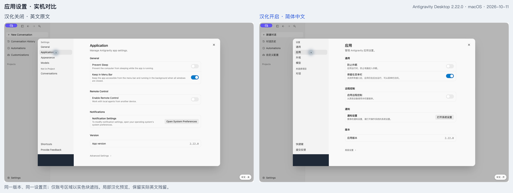
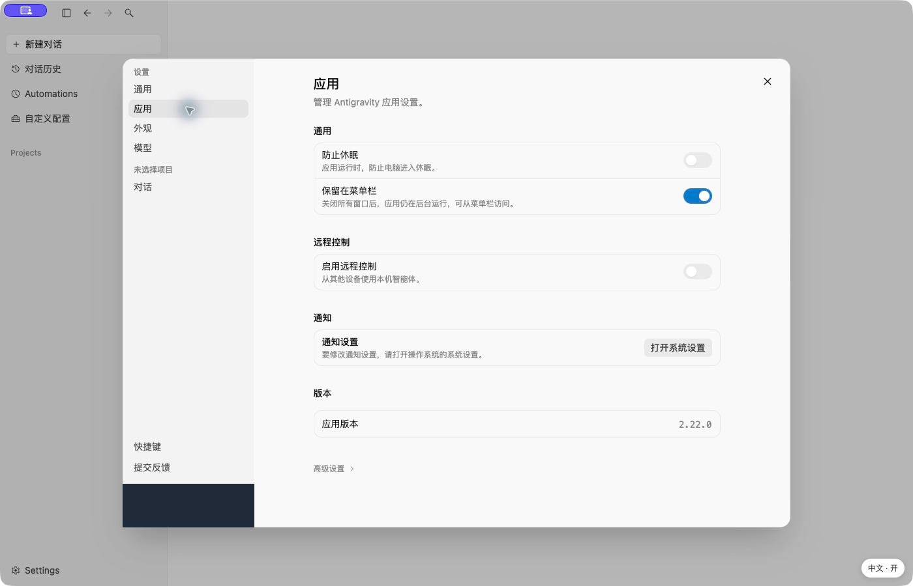
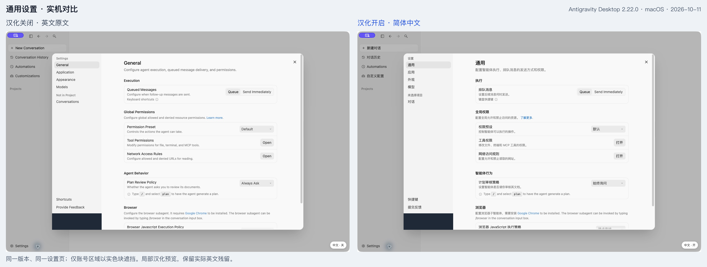
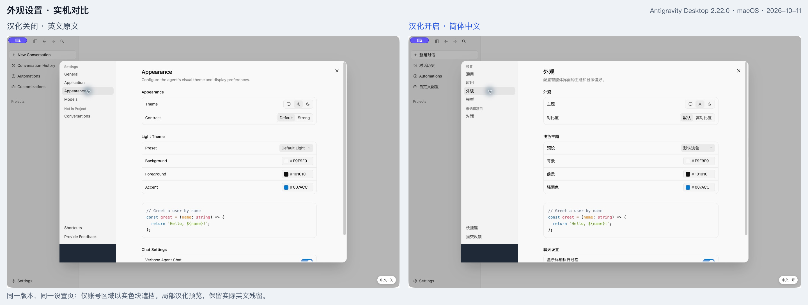

# Google Antigravity 中文汉化补丁 · 徐老师AI

[](https://github.com/TeacherXuAI/antigravity-zh-cn/actions/workflows/test.yml)
[](LICENSE)

给 **Google Antigravity（反重力）Desktop 2.22.0** 的设置页增加简体中文。独立实现的实验性社区项目，非 Google 官方产品，也不是 Antigravity IDE / VS Code 语言包。

**v0.1.0 是有限范围的预览版，不是完整汉化。** 当前词库 92 条，主要覆盖「通用、应用、外观、模型与用量」四个设置页，以及部分固定导航。其余页面保留原文。

> **实机已验证：macOS 26.5.2 / Apple Silicon / Antigravity Desktop 2.22.0。** 已确认四个目标设置页显示中文、关闭汉化恢复英文、重启默认开启，以及完整还原后恢复 Google 原签名和公证。仍是有限范围的预览版；详情见 [验证记录](docs/VALIDATION.md)。

**[下载预览版](https://github.com/TeacherXuAI/antigravity-zh-cn/releases) · [安装与还原](#install) · [实测记录](docs/VALIDATION.md) · [问题反馈](https://github.com/TeacherXuAI/antigravity-zh-cn/issues) · [认识徐老师AI](https://github.com/TeacherXuAI)**

适合正在使用上述 Mac 版本、希望看懂英文设置的用户。包含中文词库、安装检查和完整原版还原工具。

如果这个项目对你有帮助，欢迎点击右上角 **⭐ Star** 支持维护。希望接收新版本通知，可在 **Watch → Custom → Releases** 中订阅。

## 实机效果

以下为 **2026-10-11，macOS 26.5.2 / Apple Silicon / Antigravity Desktop 2.22.0** 的真实窗口截图。左侧为同一份应用关闭汉化后的英文原文，右侧为开启汉化后的中文；并非重新安装原版的对照实验。

完整窗口保留，仅用实色块遮住左下角账号区域；未用 AI 重绘或改写截图文字。部分英文仍会保留，实际覆盖范围以图中效果为准。

[](docs/images/application-comparison.png)

**[查看全部高清截图与对比说明](docs/SCREENSHOTS.md)**。上图可点击放大；可核对版本号与原有开关状态保持一致。

<details>
<summary>展开查看中文最终效果、通用页与外观页对比</summary>

### 中文应用设置：完整窗口



### 通用设置：前后对比



### 外观设置：前后对比



</details>

## 能做什么

- 翻译设置标签和说明，保留模型名称、版本号、额度数值。
- 关闭设置面板后，右下角「中文 · 开 / 关」立即切换。关闭时恢复原文；重启后默认开启。
- 不做全文替换；通过设置面板和固定导航范围定位，跳过聊天区域、代码、输入框、可编辑内容和账号按钮。
- 支持动态页面更新，不包裹或重新创建原有文本节点。
- 安装前核对版本、原始 preload 指纹、ASAR 完整性、Google 签名与 macOS 公证。
- 保留完整原版应用，提供还原命令；未知版本和已有备份会停止安装。

## 当前限制

| 项目 | 状态 |
| --- | --- |
| 目标版本 | Antigravity Desktop **2.22.0**，另核对入口文件指纹 |
| 安装平台 | macOS；当前实机环境为 Apple Silicon |
| Windows / Linux | 暂无安装器，不承诺可用 |
| Antigravity IDE | 不支持 |
| 顶部 macOS 原生菜单 | 暂未汉化 |
| 下拉弹出层、工具提示、辅助功能属性 | 暂未完整覆盖 |
| 对话、自定义技能内容、历史和项目名 | 不在汉化目标内 |
| 自动更新 | 更新可能覆盖补丁；不禁用更新，不强行覆盖新版 |
| 账号登录、地区资格、额度 | 不处理，不绕过 |

测试证据和未验证项见 [验证记录](docs/VALIDATION.md)。

## 安装前需要知道

修改 `.app` 内容会使 Google 原有外层代码签名失效。安装器会对修改后的外层应用使用**本地 ad-hoc 签名**；这不等同于 Google 官方签名或 Apple 公证。macOS 安全策略或后续更新可能拒绝这份修改版。

由于本地签名没有 Apple Team ID，还需要为修改版应用增加 `com.apple.security.cs.disable-library-validation` 权限，使它能够加载原有 Google 框架。**这会降低这一份应用对所加载动态库的身份校验，必须单独明确同意。**

安装器不关闭系统 Gatekeeper、不删除隔离属性、不关闭 Hardened Runtime、不改 Electron 的安全开关，也不启用远程调试端口。若系统阻止运行，请还原原版，不要关闭系统保护。完整原版会保存在应用旁边：`Antigravity.app.zh-cn-original`。

项目不收集遥测，不读账号凭据、不上传对话，翻译运行时代码不发起网络请求。仓库只分发原创代码和词库，不包含 Google 应用、安装包或解包后的源码。

<a id="install"></a>

## 使用

需要 Python **3.9+**。安装使用 Python 标准库，不需要安装 Node.js 或 npm 依赖。请先从 [Google 官网](https://antigravity.google/download) 安装受支持版本。

下载本仓库 ZIP 并解压，或者：

```bash
git clone https://github.com/TeacherXuAI/antigravity-zh-cn.git
cd antigravity-zh-cn
```

### 1. 只检查，不修改

```bash
python3 tools/patcher.py doctor
```

会显示版本、是否已汉化、原版备份位置和校验值。未知版本会停止，**不要为了强行安装而改版本号或指纹**。

### 2. 完全退出应用后安装

先在 Antigravity 中按 `⌘Q`。确认接受上面的签名变化后执行：

```bash
python3 tools/patcher.py install --acknowledge-signature-change --allow-local-library-loading
```

安装完成后，从「应用程序」重新打开 Antigravity，进入 Settings。关闭设置面板后，可使用右下角的中文切换按钮。请从 `/Applications/Antigravity.app` 打开修改版，避免系统按相同应用标识误选原版备份。不要手动删除 `.zh-cn-original` 备份和 `.zh-cn-state.json` 恢复记录。

自定义安装路径可使用 `--app "/完整路径/Antigravity.app"`。v0.1 拒绝符号链接路径；路径需指向真实应用目录。不建议使用 `sudo`；没有写入权限时请停止。

### 3. 还原原版

完全退出应用，然后：

```bash
python3 tools/patcher.py restore
```

会校验备份并恢复完整原版应用及其原有签名。若应用在安装补丁后被更新，工具会停止，避免用旧版备份覆盖新版。此时可保留备份并从官网重新安装，或提交不含个人信息的问题报告。

## 实现方式

```text
版本 / 指纹 / 签名检查
       ↓
准备完整应用副本 → 追加独立翻译运行时代码到 preload
       ↓
更新 ASAR 的文件校验和与 Info.plist 中的头部校验和
       ↓
明确允许本应用的动态库校验例外 → 本地签名并校验
       ↓
再次检查应用已退出、原版未变化
       ↓
保存恢复记录 → 原版改名为备份 → 替换为修改版
```

运行时只处理识别到的设置区域和固定导航，词条必须完整匹配，不使用模糊替换。关闭汉化时，仅恢复仍保持本工具译文的文本，避免覆盖应用后来更新的内容。

## 开发与测试

开发测试需要 Node.js 20+、npm 和 Python 3.9+：

```bash
npm ci --ignore-scripts
npm test
npm run build
```

- `locales/zh-CN.json`：独立的中英文词库。
- `src/runtime.js`：范围定位、动态翻译、原文恢复。
- `tools/patcher.py`：只读诊断、ASAR 更新、安装和还原。
- `tools/compatibility.json`：版本和入口文件指纹。
- `dist/antigravity-zh-cn.js`：可重复构建的完整运行时代码。
- `tests/`：DOM、ASAR、失败回滚、更新冲突和备份还原测试。

目前未提供自动跟随上游版本的补丁。支持新版本前，应重新核对实际 DOM、入口代码、签名和安装/还原流程，再更新兼容清单。

## 贡献与反馈

请看 [贡献指南](CONTRIBUTING.md)。Issue 中请只提供版本、系统、步骤和已打码的截图。不要上传邮箱、登录二维码、凭据、对话内容、完整应用或个人目录。

## 作者与交流

我是 **[徐老师AI / TeacherXuAI](https://github.com/TeacherXuAI)**，一名 AI 博主，分享 AI 工具实测、使用教程和开源小工具。

| 平台 | 如何找到我 |
| --- | --- |
| 抖音 | 搜索 **徐老师AI** |
| 视频号 | 搜索 **徐老师AI** |
| 小红书 | 搜索 **徐老师AI** |

**微信交流：`XLSbenren`**。AI 工具交流、使用体验或合作联系，添加时请备注「GitHub + 来意」。

安装报错和翻译问题请优先提交 [Issue](https://github.com/TeacherXuAI/antigravity-zh-cn/issues)，便于其他用户检索和一起解决；请勿在公开 Issue 中发送账号、凭据或未打码的个人信息。

欢迎在 GitHub **[关注我](https://github.com/TeacherXuAI)**，查看后续项目；下载和使用本项目无需关注或加微信。

## 声明

由 **徐老师AI / TeacherXuAI** 发起维护。本项目的原创代码使用 [MIT License](LICENSE)；Google Antigravity 的名称、图标、软件及其条款仍归各自权利方。本项目不代表 Google、不与其关联，也不提供授权或资格绕过。
